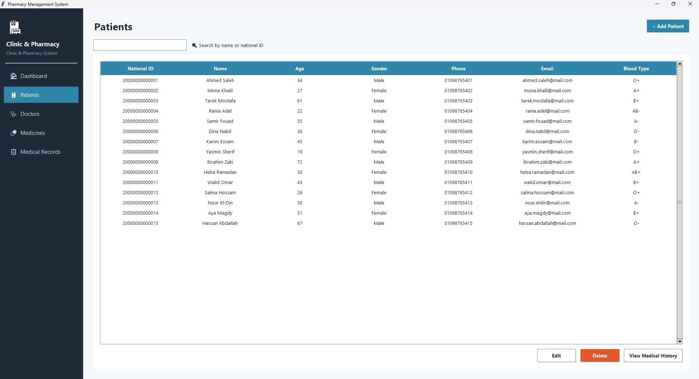
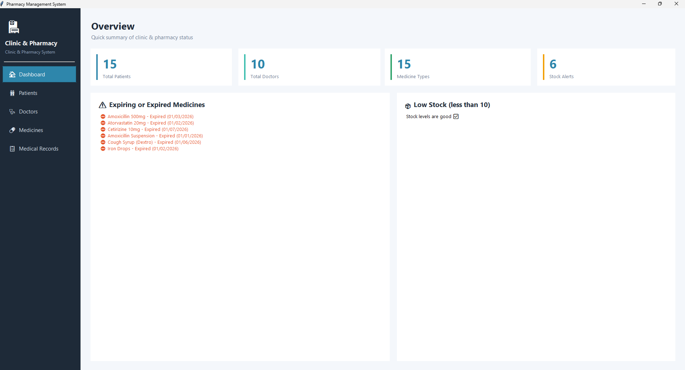
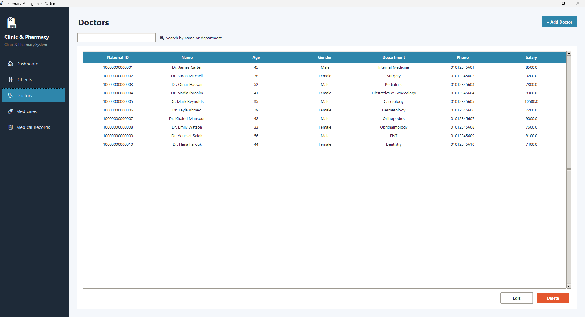
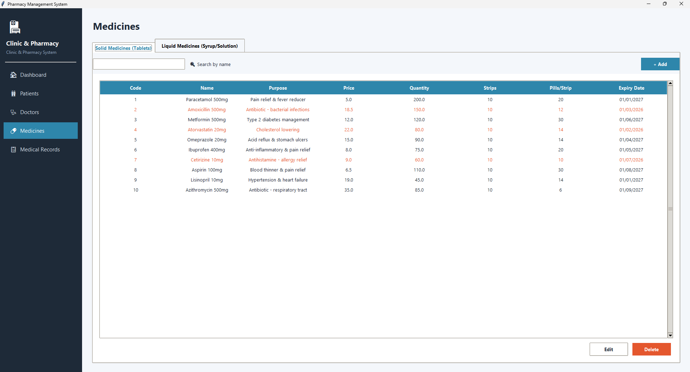

<div align="center">

#  Clinic & Pharmacy Management System

A full-featured **desktop application** for managing a clinic and pharmacy — built with pure Python, SQLite, and a modern Tkinter GUI.


</div>

---

## 📌 Overview

This project is a complete clinic & pharmacy desktop management system built from scratch as part of my programming learning journey.  
It covers **patients, doctors, medicines, and medical records** — all with persistent SQLite storage and a polished dark-themed UI.

> **Note:** This is a portfolio project intended to demonstrate OOP design, layered architecture, and database integration. It is not intended for production clinical use.

---

## ✨ Features

| Module | What it does |
|---|---|
| 🏠 **Dashboard** | Live KPIs · Expiry alerts · Low-stock warnings |
| 🧑‍🤝‍🧑 **Patients** | Full CRUD · Live search · Linked medical history |
| 🩺 **Doctors** | Full CRUD · Department & salary management |
| 💊 **Medicines** | Solid (tablets) & Liquid (syrups) with separate fields · Expiry color-coding |
| 📋 **Medical Records** | Per-patient history · Diagnosis, treatment, doctor, date & notes |

---

## 📸 Screenshots

<div align="center">

**Patients Management**


</div>

| Dashboard | Doctors |
|:---------:|:-------:|
|  |  |

| Medicines | Medical Records |
|:---------:|:---------------:|
|  |  |


---

##  Architecture

```
Clinic & Pharmacy Management System/
│
├── main.py                  # Entry point — loads session & launches UI
│
├── config.py                # App-wide constants (DB path, date format)
│
├── core/                    # Business logic layer
│   ├── models.py            # OOP models: Person → Doctor/Patient, Medicine → Solid/Liquid
│   └── session.py           # Runtime state (in-memory lists)
│
├── persistence/
│   └── database.py          # All SQLite CRUD operations
│
├── utils/
│   ├── validators.py        # Email, phone, national ID validation (regex)
│   └── utils.py             # Age calculation from national ID
│
├── ui/                      # Presentation layer (Tkinter)
│   ├── app.py               # Root window & sidebar navigation
│   ├── theme.py             # Color palette, fonts, ttk styles
│   ├── widgets.py           # Reusable components: Card, FormDialog, Toast, ConfirmDialog
│   ├── helpers.py           # UI-only glue helpers
│   └── pages/
│       ├── dashboard.py
│       ├── patients.py
│       ├── doctors.py
│       ├── medicines.py
│       └── medical_history.py
│
└── data/
    └── clinic_pharmacy.db   # SQLite database (auto-created, git-ignored)
```

---

## 🛠️ Tech Stack

| Technology | Purpose |
|---|---|
| **Python 3.8+** | Core language |
| **Tkinter / ttk** | GUI framework |
| **SQLite3** | Embedded relational database |
| **re (Regex)** | Input validation |

> No external packages required — everything is part of the Python standard library.

---

##  Quick Start

**1. Clone the repository**
```bash
git clone https://github.com/OmarKamal-Dev/Clinic-Pharmacy-Management-System.git
cd "Clinic & Pharmacy Management System"
```

**2. Run the app**
```bash
python main.py
```

That's it. The database and sample data are created automatically on first launch.

>  No `pip install` needed — Python 3.8+ is all you need.

---

##  Project Credits

| Part | Details |
|---|---|
| **Backend** — Models, business logic, database layer, validators, session management | Written entirely by me |
| **GUI** — Tkinter interface, theme, widgets, all pages | Built with AI assistance on top of the same backend (no backend changes made) |

---

##  OOP Highlights

- **Abstract base classes** — `Person` and `Medicine` define shared interfaces
- **Inheritance** — `Doctor` / `Patient` from `Person` · `SolidMedicine` / `LiquidMedicine` from `Medicine`
- **Encapsulation** — Every attribute protected via `@property` and setters
- **Class-level state** — Entity counters managed at the class level
- **Layered architecture** — `core` · `persistence` · `ui` · `utils` are fully decoupled

---

## 👤 Author

<div align="center">

**Sabarish E**  
Second-year CSE AIDE student · JAIN University. 
*Created by AIDE engineers of JAIN University*

[](https://github.com/Sabarish-25BTRAD098/25BTRAD098_Python)


</div>

---

<div align="center">
Made with Python code
</div>
